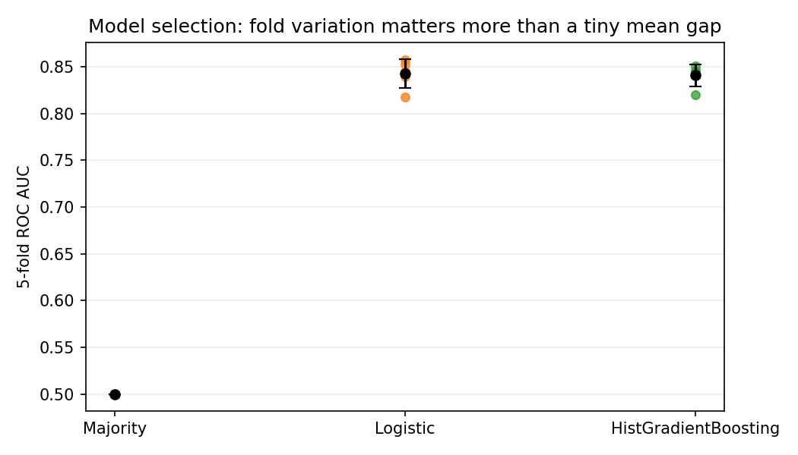
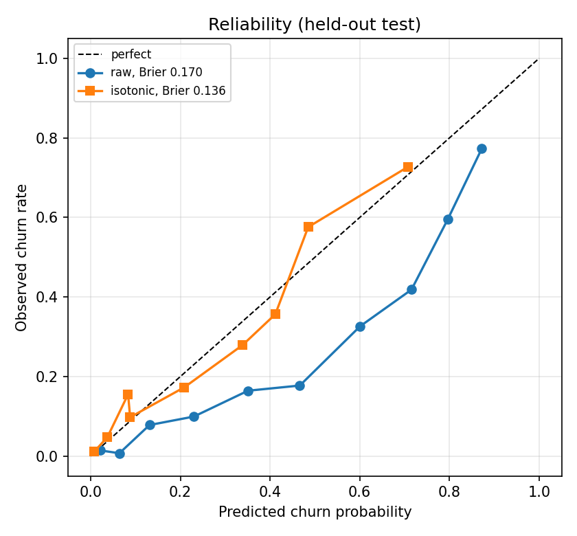
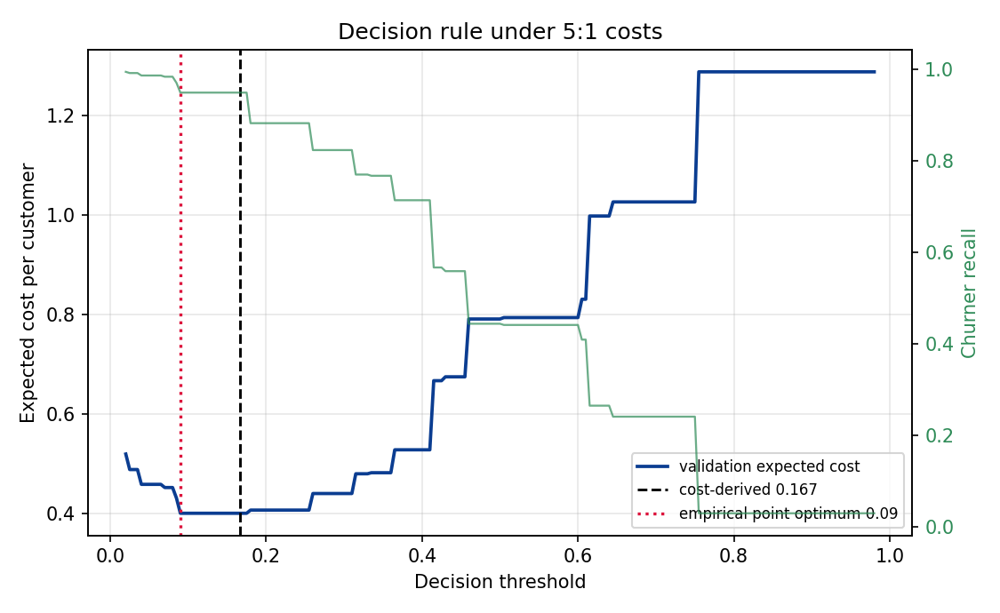
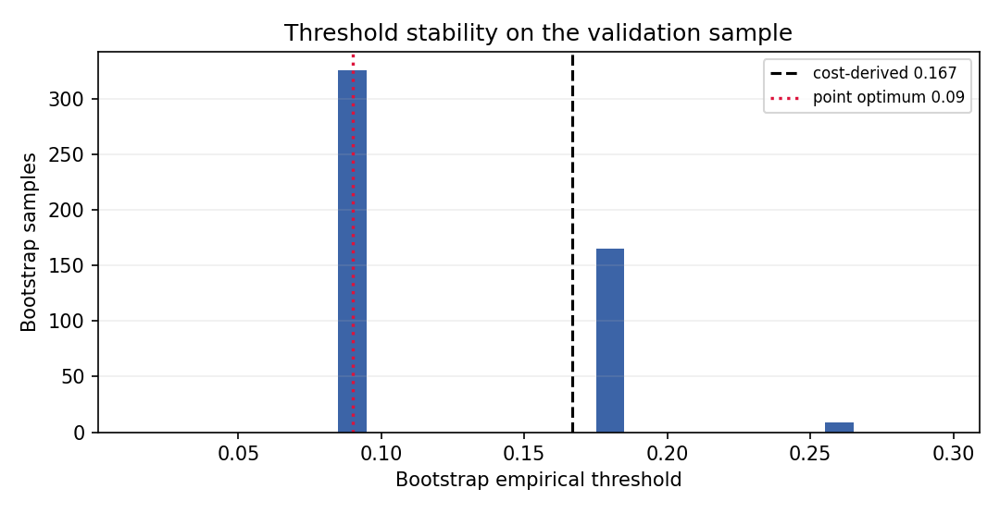
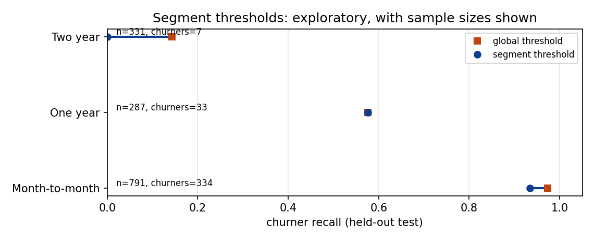
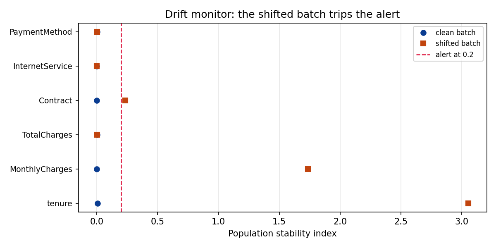

# Churn Prediction as a Decision Service

[](https://github.com/AhmadEblagh205/churn-prediction-service/actions/workflows/ci.yml)


An end-to-end machine-learning project on the **public IBM Telco customer-churn sample**. The point is not just to classify churn. The project separates **prediction, calibration and decision-making**, then carries that logic through validation, batch scoring, an API, explanations, drift monitoring and an offline model-governance simulation.

The central question is:

> If a missed churner and an unnecessary retention offer have different costs, how should a calibrated probability become an action — and how much evidence is enough before changing that policy?

## What is demonstrated

- strict schema/data validation with an auditable cleaning log;
- leakage-aware train / calibration-threshold / held-out-test splits;
- cross-validated model comparison with fold-level uncertainty;
- probability calibration evaluated on the untouched test split;
- cost-sensitive decision rules with an explicit theoretical threshold;
- bootstrap threshold-stability analysis;
- segment-level diagnostics with uncertainty before policy changes;
- a versioned model artifact, FastAPI service and target-free batch scoring;
- exact logistic **log-odds** reason codes plus protective factors;
- PSI drift monitoring with a clearly labelled synthetic shift;
- an offline champion/challenger promotion gate using cost, AUC and Brier score;
- a Streamlit stakeholder dashboard backed by testable computation.

## Results that are safe to claim

### 1. Model selection: simpler and effectively tied

Five-fold cross-validated ROC AUC on the training split:

| Model | Mean ROC AUC | Fold SD |
|---|---:|---:|
| Majority baseline | 0.500 | 0.000 |
| Logistic regression | **0.842** | 0.016 |
| Histogram gradient boosting | 0.841 | 0.012 |

The difference between logistic regression and gradient boosting is too small to present as meaningful superiority. Logistic regression is retained because discrimination is comparable and it supports exact linear log-odds reason codes.



### 2. Calibration improves out-of-sample probability quality

Isotonic calibration is fitted only on the validation split. On the **held-out test split**:

- raw logistic Brier score: **0.170**;
- calibrated Brier score: **0.136**.

Lower Brier score is better because it is the mean squared error of the predicted probabilities against the binary outcomes.



### 3. The decision threshold comes from costs, not a magic tuned number

With a false-negative cost of 5 and false-positive cost of 1, the cost-derived threshold for a calibrated probability is

\[
\frac{C_{FP}}{C_{FN}+C_{FP}} = \frac{1}{6} \approx 0.167.
\]

The validation sample has an empirical point optimum at **0.09**, but bootstrap resampling puts the empirical threshold's 95% range at **0.09–0.18**. Because isotonic calibration creates probability plateaus, 0.09 and 1/6 produce the **same validation actions** in this run. The service therefore deploys the transparent cost-derived threshold rather than over-interpreting a sample-specific optimum.





### 4. Held-out decision performance

At the deployed 5:1 cost rule on the held-out test split:

- ROC AUC: **0.843**;
- churner recall: **0.922**;
- precision: **0.410**;
- flag rate: **0.598**;
- expected cost per customer under the illustrative cost ratio: **0.456**.

These figures describe this dataset and cost assumption; they are not a claim about production performance.

### 5. Segment thresholds are audited, not automatically deployed

The two-year-contract group is a useful warning about small-sample conclusions: the held-out test group contains **331 customers but only 7 churners**. A segment-specific threshold reduces the point estimate of expected cost from **0.4556 to 0.4514**, but bootstrap uncertainty for the saving is **-0.0263 to 0.0312 per customer**.

That interval crosses zero, so the project recommendation is:

> **retain the global threshold; treat segment-specific thresholds as exploratory.**

This is deliberately more conservative than declaring a policy win from a tiny point estimate.



## Data validation

Dataset provenance, checksum and the upstream Apache-2.0 licence are recorded in [`data/README.md`](data/README.md).

The IBM sample stores `TotalCharges` as text and contains blank values for tenure-zero customers. The validator:

- converts `TotalCharges` explicitly;
- repairs a blank **only when tenure is zero**;
- raises an error for malformed/missing `TotalCharges` on non-zero-tenure rows instead of silently turning it into zero;
- checks required columns and duplicate customer ids;
- rejects negative numeric values;
- normalises `SeniorCitizen` to `Yes/No`;
- can validate training data **with** `Churn` or scoring data **without** the target.

That last point matters: a real scoring file cannot be expected to contain the future outcome being predicted.

## Feature pipeline

Numerical scaling and categorical one-hot encoding live inside a scikit-learn `ColumnTransformer`/`Pipeline`, so the same transformation is used in training, testing and serving. Unknown categories are ignored by the encoder at the model layer, while the API performs a stricter schema check and returns a clear 422 for unsupported categories.

## Explanations: exact about what they explain

Because the champion is logistic regression, each transformed feature contributes exactly

`coefficient × transformed value`

to the **uncalibrated logistic log-odds**. The service aggregates one-hot columns back to original input fields and returns both:

- top risk-raising factors;
- top protective factors.

The explanation does **not** claim to be an additive decomposition of the calibrated probability. Isotonic calibration is a monotone remapping applied after the logistic score.

## API

Run:

```bash
uvicorn serve:app --app-dir src --port 8000
```

Single prediction:

```bash
curl -X POST localhost:8000/predict \
  -H 'Content-Type: application/json' \
  -d @examples/customer.json
```

The response contains the calibrated churn probability, raw logistic probability, deployed threshold/policy, decision, risk drivers, protective factors and model version.

Batch API scoring supports up to 500 customers.

## CRM-style batch scoring without the target

`examples/batch_customers.csv` deliberately contains **no `Churn` column**.

```bash
python src/batch_score.py examples/batch_customers.csv --out reports/scored.csv
```

The output appends:

- `churn_probability`;
- `decision`;
- `top_risk_driver`;
- `top_protective_factor`.

## Drift monitoring

The artifact carries reference distributions from the training data. `monitor.py` computes population stability index (PSI) for selected numeric and categorical features.

```bash
python src/monitor.py
```

The script compares a clean sample with a **synthetically shifted** sample (shorter tenure, higher charges and a contract shift). The PSI thresholds are demonstration heuristics, not universal production standards.



The Streamlit dashboard uses the same shifted latest batch for both the drift trend and drill-down distributions, so the diagnostic view is internally consistent.

## Retraining governance: trigger is not promotion

`retrain.py` demonstrates two separate decisions:

1. **investigate retraining** when the drift rule fires;
2. **promote a challenger** only on a disjoint promotion holdout.

The promotion gate is decision-cost-first and also checks AUC and Brier-score guardrails. In the current offline simulation, the challenger passes the gate because it reduces expected cost on the promotion holdout while remaining within the discrimination/calibration tolerances.

This is an **offline random-split governance simulation on a static public sample**. It is not presented as a live or temporal retraining system.

See [`docs/DECISION_GOVERNANCE.md`](docs/DECISION_GOVERNANCE.md) for the reasoning and assumptions.

## Stakeholder dashboard

Optional dashboard dependencies:

```bash
pip install -r requirements-dashboard.txt
streamlit run src/dashboard.py
```

Five tabs:

- **Overview** — held-out calibration, score separation and cleaning log;
- **Decision** — change the miss cost and see threshold/recall/precision/cost respond;
- **Inspect** — customer what-if analysis with exact log-odds drivers;
- **Drift** — successive-batch PSI with a consistent shifted-batch drill-down;
- **Batch** — upload a target-free CRM-style file and download scores.

The numerical logic lives in `dashboard_core.py`, separate from the UI.

## Reproduce the project

```bash
pip install -r requirements-dev.txt
python src/download_data.py                   # fetch + checksum-verify public sample
python src/train.py
python src/segment_thresholds.py
python src/monitor.py
python src/retrain.py
pytest -q
```

Or run the service in Docker:

```bash
docker build -t churn-service .
docker run -p 8000:8000 churn-service
```

## Repository structure

```text
src/
  validate.py            strict schema + explicit cleaning
  features.py            shared preprocessing pipeline
  decision.py            cost rules + threshold uncertainty
  train.py               selection, calibration, evaluation, artifact
  explain.py             exact logistic log-odds attribution
  serve.py               FastAPI service
  batch_score.py         target-free CSV scoring
  monitor.py             PSI drift demonstration
  segment_thresholds.py  segment policy audit + bootstrap uncertainty
  retrain.py             offline promotion-governance simulation
  dashboard_core.py      UI-free stakeholder computations
  dashboard.py           Streamlit stakeholder surface
reports/
  training_summary.json
  segment_thresholds.json
  drift_report.json
  retrain_decision.json
  figures/
models/
  churn-2.0.0.joblib
```

## Limits

- public static sample, not a longitudinal production cohort;
- illustrative constant decision costs rather than customer-level economics;
- PSI cut-offs are heuristics;
- segment findings can be unstable when churn counts are small;
- the retraining workflow is an offline governance demonstration;
- no authentication/authorisation layer is included in the example API/dashboard.

## Licence

MIT for the code; dataset source is the public IBM Telco customer-churn sample downloaded by `src/download_data.py`.
